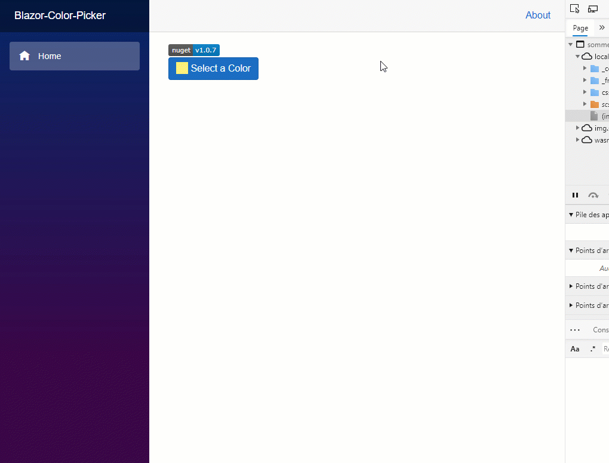

# Blazor-Color-Picker
[](https://www.nuget.org/packages/BlazorColorPicker/) 
[](https://github.com/tossnet/Blazor-Color-Picker/blob/master/LICENSE)

Sometimes HTML5 colorpicker doesn't suit me for an application. I prefer to offer the user a predefined color palette

DEMO : https://tossnet.github.io/Blazor-Color-Picker/

Opens a palette with the Material colors




# Installation

> [!WARNING]
> The implementation has been improved: version 4.0 uses a service declared via dependency injection

Latest version in here: [](https://www.nuget.org/packages/BlazorColorPicker/)

To Install

```
Install-Package BlazorColorPicker
```
or
```
dotnet add package BlazorColorPicker
```
For client-side and server-side Blazor - add script section to index.html or _Host.cshtml (head section)

```html
<link href="_content/BlazorColorPicker/colorpicker.css" rel="stylesheet" />
```

In program.cs, declare 

```csharp
builder.Services.AddColorPicker();
```

**ColorPicker** are rendered by the `<BlazorColorPicker.ColorPicker />`. This component needs to be added to the main layout of your application/site. You typically do this in the `MainLayout.razor` file at the end of the <main> section.

## Usage

```html
@page "/"
@using BlazorColorPicker

@inject IColorPickerService ColorPickerService

<button class="btn btn-primary" @onclick="OpenModal">
    <div style="background-color:@color" class="buttonColor"></div> Select a Color
</button>

@code {
    private string color = "#F1F7E9";

    private async Task OpenModal()
    {
        var parameters = new ColorPickerParameters
        {
        	ColorSelected = color,
        };
        color = await ColorPickerService.ShowColorPicker(parameters);
    }
}
```

## Z-Index

By default the color picker modal uses `z-index: 9999`. If your app has a parent element with a higher z-index, the palette may appear behind it. Two override options are available:

**Option 1 — CSS custom property** (global, no code change needed):
```css
:root {
    --color-picker-z-index: 999999;
}
```

**Option 2 — `ZIndex` parameter** (per call):
```csharp
var parameters = new ColorPickerParameters
{
    ColorSelected = color,
    ZIndex = 999999,
};
color = await ColorPickerService.ShowColorPicker(parameters);
```

## Find Closest Color

When the selected color doesn't exist in the palette, you can enable automatic matching to the closest available color using the `FindClosestIfNotFound` parameter:

```csharp
var parameters = new ColorPickerParameters
{
    ColorSelected = "#8B4513",  // SaddleBrown - not in the default palette
    FindClosestIfNotFound = true,
};
color = await ColorPickerService.ShowColorPicker(parameters);
```

The algorithm uses a **weighted Euclidean distance** in RGB color space, which accounts for human color perception (green differences are more noticeable than red or blue).

> [!NOTE]
> Color comparison is case-insensitive: `#ec407a` will match `#EC407A` in the palette.

## Intensity & Hue sliders

Two optional sliders adjust the whole Material palette live (HSL, computed in C#, no JS interop). Both are **off by default** and can be enabled independently:

- `ShowIntensitySlider` (vertical, 0..200, neutral 100): up = more vivid and slightly darker, down = greyer and lighter.
- `ShowHueSlider` (horizontal, -180..+180, neutral 0): rotates the hue; pure greys don't move.

Near the neutral position (±4 intensity, ±7 hue), the mouse snaps back to neutral. The keyboard doesn't snap. Adjust the sliders first, then click a cell: the cell's adjusted color is returned.

Sliders only apply to the default palette. They are ignored when `MyColorPallet` is set.

### Restoring the palette exactly

An adjusted color can't be mapped back to slider positions from its hex alone, so store the palette state with your setting. Use `ShowPaletteChoice`, which returns a `PaletteChoice(BaseHex, Intensity, Hue, Hex)`. The cell is identified by its original Material color (`BaseHex`), so the stored JSON stays readable:

```json
{"BaseHex":"#673BB7","Intensity":99,"Hue":61,"Hex":"#634EE1"}
```


```csharp
private string color = "#2196F3";
private string? state; // JSON stored with the setting

var parameters = new ColorPickerParameters
{
    ColorSelected = color,
    ShowIntensitySlider = true,
    ShowHueSlider = true,
    PaletteChoice = PaletteChoice.Resolve(state, color), // state if present, else FromHex(color)
};

var choice = await ColorPickerService.ShowPaletteChoice(parameters);
if (choice is not null)
{
    color = choice.Hex;
    state = choice.ToJson();
}
```

- `PaletteChoice.Create("#2196F3")` creates a state from a palette color (sliders at neutral, or pass `intensity` / `hue`).
- `PaletteChoice.FromHex(hex)` finds the closest cell + slider combination. It returns `null` if the closest one is more than 12 apart (RGB distance). Then no cell is checked and the sliders stay neutral.
- `OnPaletteChoiceChanged` (optional) is called each time the state changes while the palette is open.

## <a name="ReleaseNotes"></a>Release Notes

<details open="open"><summary>Version 4.5.0</summary>

>- Optional Intensity and Hue sliders (`ShowIntensitySlider`, `ShowHueSlider`), off by default
>- `PaletteChoice` state, `ShowPaletteChoice`, `FromHex` and JSON persistence to restore the palette exactly
>- `IColorPickerService` gains `ShowPaletteChoice` (custom implementations of the interface must add it)
</details>

<details><summary>Version 4.4.0</summary>

>- Configurable z-index via `ZIndex` parameter or CSS custom property `--color-picker-z-index` (default: 9999)
</details>

<details><summary>Version 4.2.0</summary>

>- New feature: `FindClosestIfNotFound` parameter - when the selected color is not in the palette, automatically highlights the closest matching color
>- Color comparison is now case-insensitive (`#ec407a` matches `#EC407A`)
>- Uses weighted Euclidean distance algorithm for perceptually accurate color matching
</details>

<details><summary>Version 4.1.1</summary>

>- Performance & memory optimization: default colors are now static and shared across all instances
>- Fixed memory leak in OnParametersSet() that caused unbounded list growth
>- Zero allocations when using default color palette
</details>

<details><summary>Version 4.0.2</summary>
>- Added AddColorPicker() to simplify declaration
</details>

<details><summary>Version 4.0.1</summary>
>- increase the z-index to 9999
</details>

<details><summary>Version 4.0.0</summary>
>- the implementation has been improved: version 4.0 uses a service declared via dependency injection
</details>

## ⚠️ Breaking changes ⚠️

<details><summary>Version 3.1.0</summary>
>- you can customise the size of the palette using your CSS styles
>- A red colour of the first column was not correct
>- Re-addition of .NET7 compatibility
</details>

<details><summary>Version 2.2.0</summary>
    
>- Remove the internal use of IJSRuntime
</details>

<details><summary>Version 2.1.0</summary>
    
>- no need to declare the _content/BlazorColorPicker/colorpicker.js file
</details>


